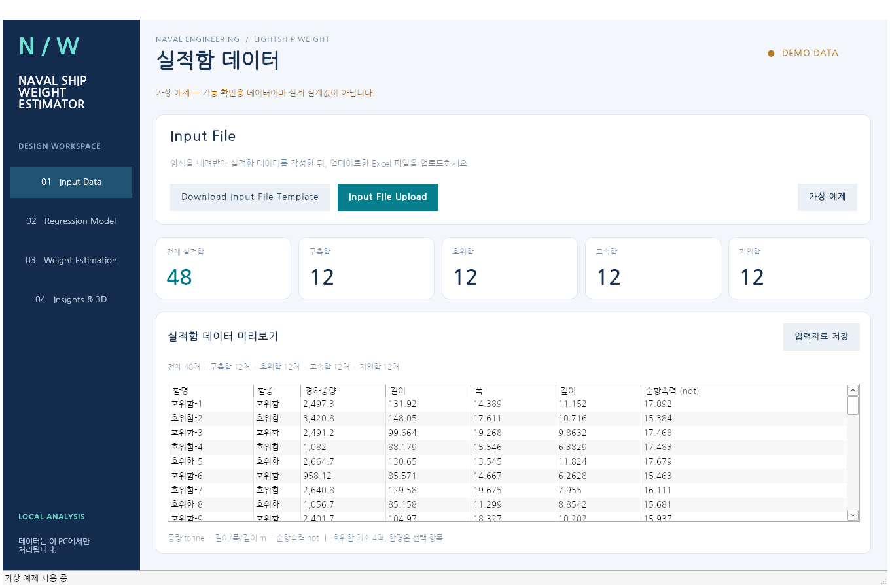

# Naval Ship Weight Estimator

Windows 데스크톱 GUI에서 실적함 엑셀로 회귀계수를 산출하고, 새 함정의 제원으로 경하중량을 추정합니다. Python 설치·브라우저·웹서버가 필요하지 않은 EXE를 제공합니다.

[Windows 실행파일 다운로드](https://github.com/21227386/regression-analysis/raw/refs/heads/main/downloads/Naval%20Ship%20Weight%20Estimator.exe)

## 사용 순서

1. EXE를 실행하고 **Download Input File Template**을 누릅니다.
2. Excel에서 실적함 자료를 작성합니다. 필수 열은 `함종, 경하중량, 길이, 폭, 깊이, 순항속력 (not)`입니다. `함명`은 선택입니다. 단위는 tonne, m, not이며 not는 knot(노트)와 같은 의미입니다.
3. **Input File Upload**를 누르면 계수가 자동으로 계산됩니다. 여러 시트가 있으면 자료 시트를 선택합니다.
4. **회귀계수·실적 비교**에서 K, α, β, 함종별 D_T와 적합 오차를 확인합니다.
5. **설계 함정 중량 추정**에서 함종·길이·폭·깊이·순항속력을 입력합니다. 설계 함정의 중량을 입력할 필요는 없습니다.
6. **그래프·3차원 곡면**에서 실적과 예측의 비교, 함종별 곡면과 로그 평면을 확인합니다. 그래프 도구모음에서 이미지를 저장할 수 있습니다.

함종은 구축함·호위함·고속함·지원함입니다. 최대속력 자료를 순항속력으로 자동 환산하지 않습니다. 깊이는 흘수와 구분하세요.

## 추정 방식과 한계

`W = S × K × (L×B×H)^α × Vc^β × D_T`

호위함의 D_T=1로 고정하고 호위함 자료만으로 로그 최소제곱 회귀계수 K, α, β를 추정합니다. 이 계수를 고정한 뒤 다른 함종의 D_T는 `실적중량 / [S×K×(LBH)^α×Vc^β]`의 기하평균으로 구합니다. 보정을 선택하지 않으면 S=1입니다.

호위함 자료는 최소 4척이 필요하며 크기·속력에 독립적인 변화가 있어야 합니다. 자료가 없는 함종의 계수는 추정하지 않습니다. 과거 모형은 새 자료로 적합할 수 없을 때 재사용하지 않습니다. 자료 수 증가만으로 예측 정확도 향상이 보장되지는 않습니다. 표시되는 MAE·RMSE·MAPE·R²는 학습 자료의 적합 지표이며 독립 검증 성능이나 예측구간은 아닙니다.

처음에는 실제 자료 없이 빈 화면으로 시작합니다. **가상 예제 보기**는 기능 확인용이며 실제 설계에 사용할 수치가 아닙니다.

## 추가 자료와 저장

**Input File Upload**로 업데이트한 실적함 Excel 파일 전체를 업로드하세요. 새 파일이 기존 입력자료를 교체하고 전체 자료로 다시 학습합니다. 자료 추가 버튼은 제공하지 않습니다. **입력자료 저장**으로 현재 자료를 Excel에 저장할 수 있습니다. 자동 누적 저장은 하지 않습니다.

**계수·실적 비교 엑셀 저장**은 입력자료, 회귀계수, 함종별 D_T, 실적함 비교, 적합 지표의 5개 시트를 저장합니다.

## Windows 실행

Windows 10/11 64비트용입니다. 첫 실행에서 필요한 파일을 사용자 LocalAppData에 자동 준비하고, 다음 실행부터 재사용합니다. PowerShell이나 Python 설치, 인터넷 연결, 웹서버가 필요하지 않습니다. 약 512MB 이상의 디스크 여유 공간을 확보하세요.

새 버전의 캐시는 `%LOCALAPPDATA%/NavalShipWeightEstimator/Desktop_v4`입니다. 실행 오류 시 이 폴더의 `startup.log`, `runtime.log`를 확인하세요. 이전 버전 캐시를 직접 지울 필요는 없습니다.

## 소스로 실행

Windows Python 3.12에서:

```bat
python -m venv .venv
.venv\Scripts\python -m pip install -r requirements-desktop-lock.txt
.venv\Scripts\python desktop_app.py
```

`workflow.py`는 자료 불러오기·재학습·예측·결과 저장을 담당하고, `desktop_app.py`는 Windows 네이티브 GUI입니다. `packaging/desktop_launcher.c`는 단일 EXE에서 내장 ZIP을 준비하고 GUI를 실행합니다. 라이선스는 각 런타임/라이브러리와 `packaging/vendor/miniz/LICENSE`, `assets/fonts/OFL.txt`를 참고하세요.

회귀·엑셀·워크플로 테스트 17개가 통과했습니다. Wine 10.0에서 실제 Windows용 GUI의 엑셀 읽기·자동 학습·예측·입력 파일 교체·결과 저장·3D/로그 그래프 동작을 확인했고, 단일 EXE의 첫 파일 준비와 창 열림도 확인했습니다. Windows 호환 환경(Wine)의 검증은 실제 Windows PC 검증과 구분합니다. 이전 브라우저 버전의 설명은 [docs/LEGACY_WEB.md](docs/LEGACY_WEB.md)에 있습니다.

## 화면 예시

아래 화면은 가상 예제 자료로 확인한 GUI입니다. 표시된 중량은 실제 설계값이 아닙니다.


